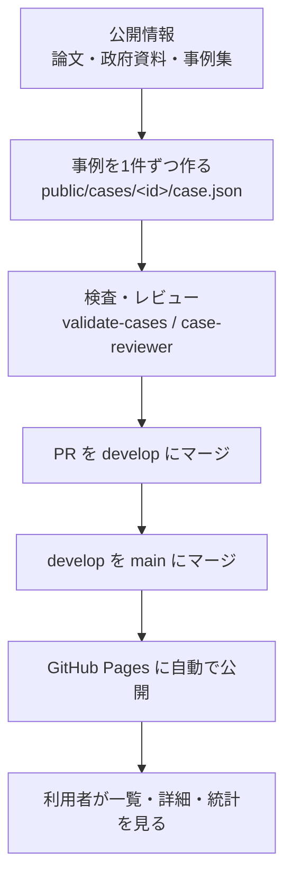
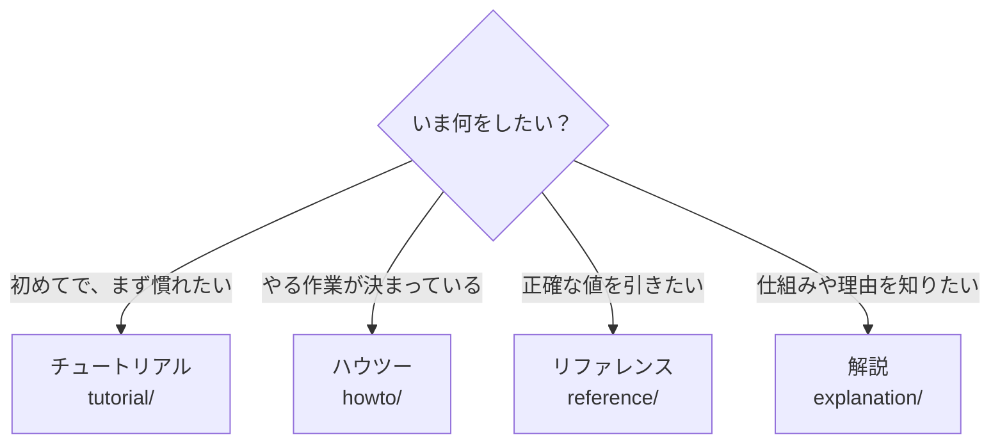

# 開発者ドキュメント

PETs活用事例カタログの開発者向けドキュメントの入口です。人（初めて触る人を含む）と AI（Claude Code など）が、同じものを読んで作業します。

- ブラウザで読む：[閲覧ページ](https://raw.githack.com/pwscup/pets-usecase-catalog/develop/docs/index.html)（目次つき。`develop` の最新を表示）
- 5分でつかむ：[スライド](https://raw.githack.com/pwscup/pets-usecase-catalog/develop/docs/slides.html)（原本は [slides.md](slides.md)）

## このリポジトリは何か

プライバシー強化技術（[PETs](glossary.md#pets)）の実世界の活用事例を、公開情報から集めて整理し、検索・閲覧できる Web カタログです。サーバーはなく、事例データ（JSON）と画面（React）を [GitHub Pages](glossary.md#github-pages) で配信しています。

## 読み方

読む目的で4種類に分けています（[Diátaxis](glossary.md#diataxis) という考え方です）。

## 初めての人が読む順番

1. [スライド](slides.md)：全体を5分でつかむ
2. [はじめての貢献](tutorial/first-contribution.md)：手元で動かして、事例を1件直して、PR を出すまでを体験する
3. [全体の構成](explanation/architecture.md)：データがどこから来て、どう表示されるか

## 全ドキュメント

| 種類 | ドキュメント | 中身 |
|---|---|---|
| 案内 | [README（このページ）](README.md) | 入口・地図・読む順番 |
| 案内 | [用語集](glossary.md) | つまずきやすい言葉 |
| 案内 | [スライド](slides.md) | 5分でわかる要点 |
| チュートリアル | [はじめての貢献](tutorial/first-contribution.md) | 手元で動かす → 小さな変更 → PR → 確認 → 本番 |
| ハウツー | [事例を1件追加する](howto/add-case.md) | 文献から case.json を作り、PR にする |
| ハウツー | [事例集からまとめて取り込む](howto/import-from-repository.md) | OECD・UN などの事例集を照合して取り込む |
| ハウツー | [既存の事例を補完する](howto/enrich-case.md) | 追加の文献で情報を足す・出典を足す |
| ハウツー | [事例をレビューする](howto/review-case.md) | `ai_generated` を `human_reviewed` に上げる |
| ハウツー | [選択肢を増やす](howto/add-option.md) | 分野・ユースケース分類・技術カテゴリを足す |
| ハウツー | [本番に出す](howto/release.md) | `develop` を `main` にマージして公開する |
| ハウツー | [CI が落ちたとき](howto/fix-ci.md) | 原因の切り分けと直し方 |
| ハウツー | [ドキュメントを書く](howto/write-docs.md) | 置き場所・書き方・表示の確かめ方 |
| リファレンス | [ファイルとフォルダ](reference/files.md) | どこに何があるか |
| リファレンス | [コマンド](reference/commands.md) | npm スクリプトと Claude Code スキル |
| リファレンス | [case.json の形式](reference/case-json.md) | 全項目・選択肢・図の形式 |
| リファレンス | [画面と URL](reference/url.md) | 画面の URL とクエリパラメータ |
| リファレンス | [環境と自動処理](reference/environments.md) | 公開先・CI・権限・困ったとき |
| 解説 | [全体の構成](explanation/architecture.md) | データの流れと画面の仕組み |
| 解説 | [事例の作り方とレビューの仕組み](explanation/review-lifecycle.md) | AI 生成から人のレビューまで |
| 解説 | [設計の原則](explanation/principles.md) | 出典・表現・データについての決まりと理由 |
| 解説 | [これまでの判断と失敗](explanation/history.md) | 新しいものが上 |

## 困ったとき

| 症状 | 行き先 |
|---|---|
| 言葉の意味がわからない | [用語集](glossary.md) |
| `npx tsx scripts/validate-cases.ts` が通らない | [case.json の形式](reference/case-json.md) の「検査の内容」 |
| CI が赤い | [CI が落ちたとき](howto/fix-ci.md) |
| 追加した事例が一覧に出ない | [環境と自動処理](reference/environments.md) の「困ったとき」 |
| なぜこうなっているのか知りたい | [これまでの判断と失敗](explanation/history.md) |
| どれにも当てはまらない | GitHub の Issue に書く |
