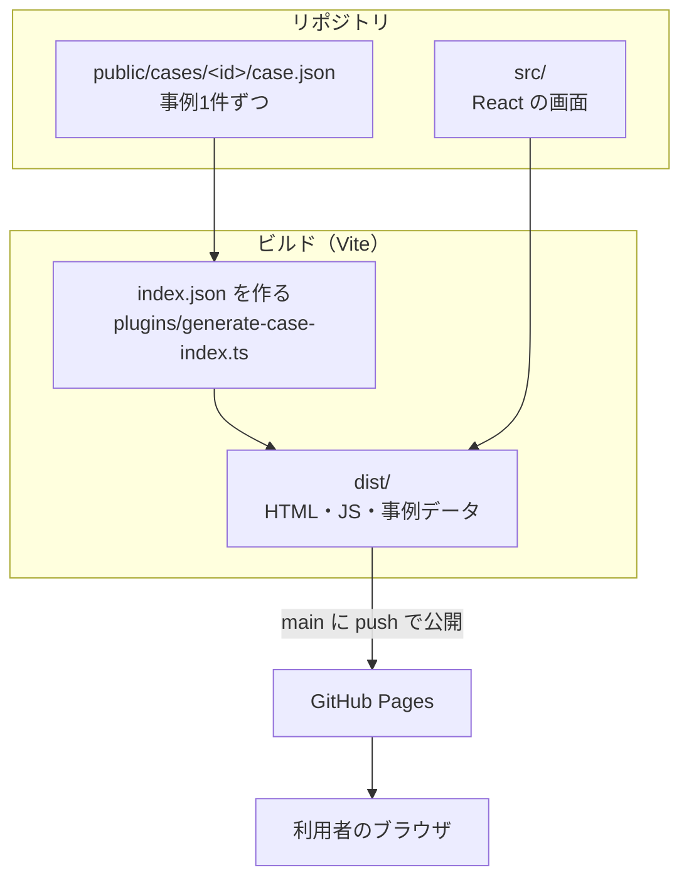
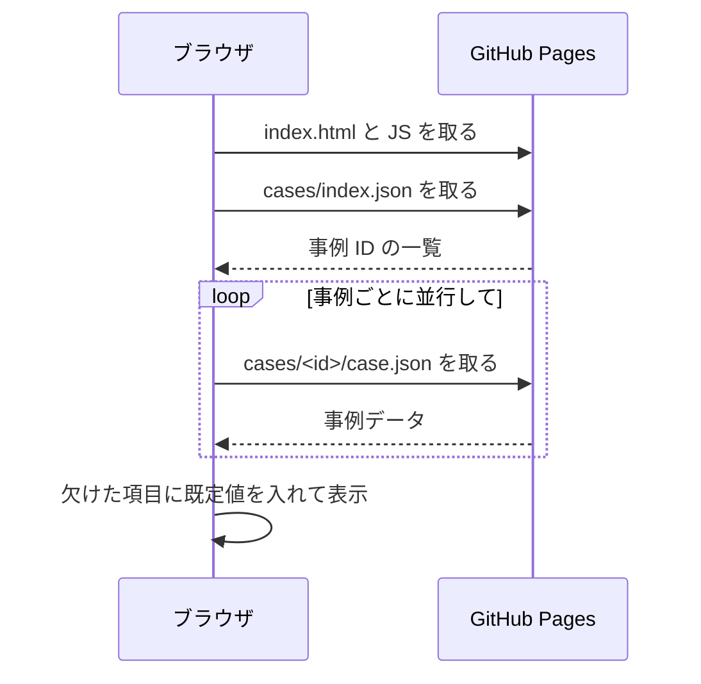

# 全体の構成

このカタログには、サーバーもデータベースもありません。事例データは JSON ファイルで、画面はブラウザの中だけで動きます。なぜそうしているか、データがどう流れて画面に出るかを説明します。

## 全体像

## なぜサーバーが無いのか

- 事例は公開情報だけで作るので、隠すデータがない
- 事例の追加・変更は PR で行うので、変更の記録とレビューが GitHub に残る
- 静的ファイルなら GitHub Pages に無料で置けて、運用の手間がほとんどない

その代わり、画面から事例を直接保存することはできません。画面で作った事例は、JSON を GitHub に貼って PR にします（「GitHubで提出」）。

## データの読み込み

- `index.json` は、ビルドのたびに `public/cases/` のフォルダを数えて作り直します。手で書くと、追加し忘れや消し忘れが起きるためです（[これまでの判断と失敗](history.md)）
- 読み込みは `src/lib/data-loader.ts`。`title` か `id` が無い事例は読み飛ばします。`technology_category` が無ければ `["synthetic_data"]`、`review_status` が無ければ `ai_generated` を入れます。このカタログが合成データだけを扱っていた頃のデータを、そのまま読むためです
- 読み込んだ事例は `src/context/CaseContext.tsx` が画面全体に渡します

## 画面の仕組み

| 仕組み | 場所 | ポイント |
|---|---|---|
| ルーティング | `src/App.tsx` | `HashRouter`。GitHub Pages はサーバー側でパスを振り分けられないので、`#` 以降で画面を切り替える |
| 検索・フィルタ | `src/hooks/useFilter.ts` | 状態を URL のクエリに入れる。URL を共有すると同じ絞り込みが再現できる |
| 図 | `src/components/figures/` | case.json の `figures` の構造データから描く。画像ファイルは持たない |
| フォーム | `src/components/case-form/` | `src/schemas/case.schema.ts`（Zod）で検査する |
| AI アシスト | `src/constants/prompts.ts` | プロンプトの原本。選択肢は `categories.ts` から読むので、選択肢を足してもプロンプトは自動で変わる |

## 検査が2つある理由

| 検査 | 場所 | 見ること |
|---|---|---|
| ファイルの検査 | `scripts/validate-cases.ts`（CI とデプロイ） | 読み込めないファイルが本番に出ないこと（必須項目・`id` とフォルダ名・`sources`） |
| 形の検査 | `src/schemas/case.schema.ts`（フォーム） | 画面で入力した値が正しい形か（選択肢・型） |

ファイルの検査は、画面が壊れないための最低限に絞っています。選択肢の値などは、ファイルの検査では見ていません。内容の正しさは、人と `case-reviewer` のレビューで確かめます（[事例の作り方とレビューの仕組み](review-lifecycle.md)）。

## 関連

- ファイルの一覧：[ファイルとフォルダ](../reference/files.md)
- 公開の仕組み：[環境と自動処理](../reference/environments.md)
