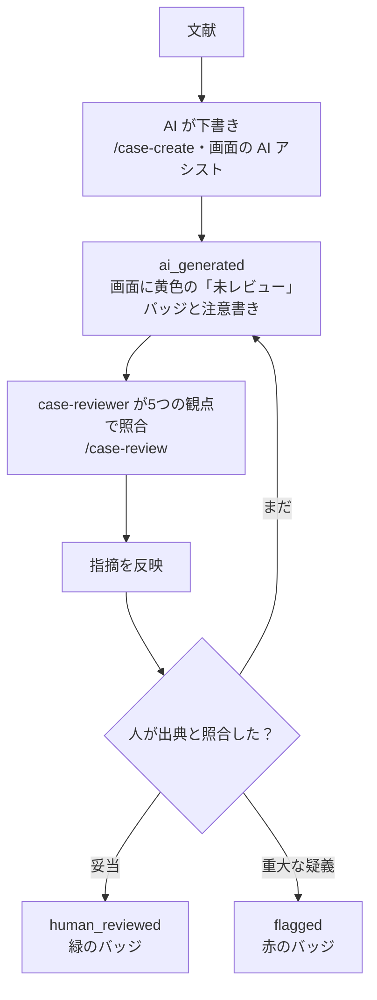

# 事例の作り方とレビューの仕組み

事例の多くは AI が文献から下書きし、人が出典と照合して確かめます。AI に任せる部分と人が見る部分を、`review_status` で分けています。その理由と仕組みを説明します。

## 流れ

## なぜ AI 生成とレビュー済みを分けるのか

- 事例は数百件規模になり、すべてを人が一から書くのは現実的でない
- 一方で、AI は文献に無いことを書くことがある。もっともらしい文ほど、誤りに気づきにくい
- そこで、人の目がまだ入っていないものは「未レビュー」と画面にはっきり出し、読む人が割り引いて読めるようにする。人が確かめたものだけを「レビュー済」にする
- 表示名を「AI生成」ではなく「未レビュー」にしているのは、読む人にとって大事なのが「誰が書いたか」より「人が確かめたか」だからである。データの値は `ai_generated` のまま

`case-reviewer`（AI）のレビューは、人のレビューの代わりではありません。人が見る前に、明らかな食い違いを減らすためのものです。

## case-reviewer の5つの観点

| 観点 | 見ること |
|---|---|
| ファクトチェッカー | 出典と事実が合っているか。主体・関係・実施段階 |
| ビジネスレビュアー | 技術者でない人が60秒で理解できるか。summary と value_proposition の役割分担 |
| PETs 技術レビュアー | 技術の区別と分類が正確か。手法・パラメータ・評価が出典と一致するか |
| 技術広報レビュアー | 言い過ぎ（「実証」を「実現」と書くなど）、誇張、根拠のない比較 |
| アカデミックレビュアー | 主張から出典をたどれるか。一次資料と二次情報の区別。数値の出どころ |

定義は `.claude/agents/case-reviewer.md` と `.claude/skills/case-review/SKILL.md`。

## レビューで見つかりやすい誤り

PR #233 で、`case-reviewer` が実際に見つけた誤りです。

| 誤り | 例 |
|---|---|
| 別のものと取り違える | 同じ組織の別プロジェクトの活動を、事例のものとして書く |
| 関連研究を同じ実験とみなす | 同じ研究者のポスターの数値を、事例の PoC の結果として書く |
| 段階を上げて書く | PoC を「実現」、計画を「導入」と書く |
| 限定を落とす | 出典の「概ね」「自らの知る限り」を省く |
| 相対値を絶対値のように書く | 「基準群比で90%向上」を「90%向上」と書く |

どれも、文として自然に読めてしまうのが共通点です。そのため、レビューでは文の読みやすさではなく、出典の該当箇所と1文ずつ照らし合わせます。

## 関連

- 手順：[事例をレビューする](../howto/review-case.md)
- 表現の決まり：[設計の原則](principles.md)
