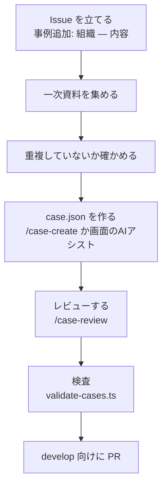

# 事例を1件追加する

文献（Web ページ・PDF・論文）から新しい事例を作り、PR にするまでの手順です。

- **実例**：Issue #230 → PR #231（NTTデータなど4件）、PR #233（OECD 掲載の6件）
- 項目の正確な定義は[case.json の形式](../reference/case-json.md)、書き方の考え方は[設計の原則](../explanation/principles.md)

## 全体の流れ



## 1. Issue を立てる

タイトルは `事例追加: <組織名> — <事例の内容>（<技術>）` にします。本文は #230 を手本に、次の見出しで書きます。

| 見出し | 書くこと |
|---|---|
| 概要 | 技術カテゴリ・組織・地域 |
| 掲載方針 | 載せるか迷う点があれば、その判断（例：技術実証だけの事例を載せるか） |
| 事例の要点 | 検索時点でわかっていること。「case.json 作成時に一次情報で要確認」と添える |
| 情報源候補 | URL の一覧 |
| 作成時に確認する事項 | チェックリスト |
| 作業手順 | 下の手順3〜6 |

## 2. 一次資料を集める

- 当事者や公的機関の資料（報告書・論文・公式発表）を優先します
- 検索結果の要約や解説記事は、一次資料を探す手がかりとして使い、出典の主体にはしません
- 開けなかった資料は、出典に載せる場合でも `note` に「本文未確認」と書きます

> **よくある失敗**：検索の要約に書かれていた内容を、一次資料に書いてあると思い込んでしまう。PR #233 では、別プロジェクトのレッドチーミングを事例のものとして書いてしまった（[これまでの判断と失敗](../explanation/history.md)）。

## 3. 重複していないか確かめる

組織名と、日本語・英語のキーワードの両方で検索します。

```bash
grep -l -i "<組織名やキーワード>" public/cases/*/case.json
```

同じ事例が見つかったら、新しく作らずに[既存の事例を補完する](enrich-case.md)に切り替えます。

## 4. case.json を作る

やり方は2つあります。

| やり方 | 向いている人 | 手順 |
|---|---|---|
| Claude Code のスキル | Claude Code を使える人 | `/case-create <文献のURL>` |
| 画面の AI アシスト | ブラウザだけで作業したい人 | 一覧の「新規作成」→「AI で入力を補助する」でプロンプトをコピー → AI に文献と一緒に渡す → 出力を「AIの出力をインポート」に貼る |

どちらも、文献から次を埋めます。

- `title` は `{組織名}：{事例の内容}`。技術名は入れない。40〜60文字が目安
- `summary` は課題と背景だけ。解決策は書かない
- `value_proposition` は PETs でどう解決し、何が得られたか
- 読み取れない項目は「調査中」
- `review_status` は `ai_generated`

新しい事例 ID には UUID を使います。

```bash
python3 -c "import uuid; print(uuid.uuid4())"
```

フォルダ `public/cases/<UUID>/` を作り、その中に `case.json` を置きます。`id` はフォルダ名と同じにします。

## 5. レビューする

```
/case-review <事例ID>
```

`case-reviewer` エージェントが、5つの観点（事実確認・読者の理解・技術・広報・引用の厳密さ）で出典と照らし合わせます。指摘を反映してから次に進みます。

> レビュー後も `review_status` は `ai_generated` のままです。`human_reviewed` に上げるのは、人が出典と照合したときだけです（[事例をレビューする](review-case.md)）。

## 6. 検査して PR を出す

```bash
npx tsx scripts/validate-cases.ts
npm run test
npm run build
```

PR は `develop` 向けに出します。本文には次を書きます。

- 作った事例の一覧（ID と組織名）
- 出典の主体にした一次資料
- 確かめたこと（上の3つのコマンド、レビューの結果）
- 判断に迷った点

## チェックリスト

- [ ] 重複を確かめた
- [ ] `sources` が1件以上あり、各 `note` に何を参照したか書いた
- [ ] 読み取れない項目を「調査中」にした（空欄にしていない）
- [ ] `/case-review` の指摘を反映した
- [ ] `npx tsx scripts/validate-cases.ts` が通った

## 困ったとき

| 症状 | よくある原因 | 対処 |
|---|---|---|
| 出典のサイトが開けない | ボット対策・アクセス制限 | 同じ内容の一次資料を別に探す。公式の RSS や API がないか見る（[事例集からまとめて取り込む](import-from-repository.md)） |
| `validate` で `id ... does not match directory name` | `id` とフォルダ名が違う | どちらかに揃える |
| 一覧に出ない | `case.json` のパスが違う、`title` か `id` がない | [環境と自動処理](../reference/environments.md)の「困ったとき」 |
| 1つの資料に複数の事例がある | — | 事例ごとに別の `case.json` にする |
