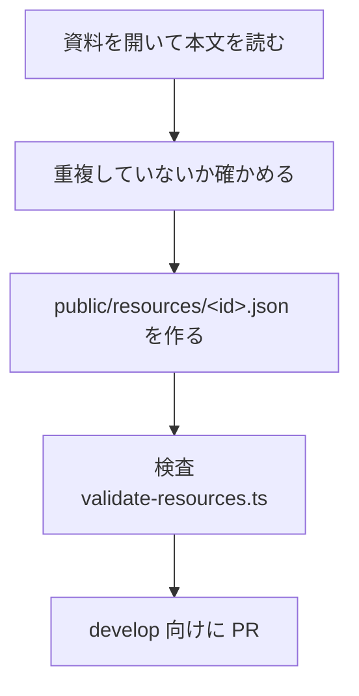

# 参考資料を1件追加する

事例ではなく「読んだほうがいいもの」（事例集・当局のガイド・報告書・標準など）を、参考資料のリストに足す手順です。

- **実例**：Issue #244（初版の14件）
- 項目の定義は[参考資料の形式](../reference/resources-json.md)

## 何を載せるか

| 載せる | 載せない |
|---|---|
| 当局・国際機関のガイドや報告書 | 製品の紹介ページ・営業資料 |
| 事例をまとめて紹介している事例集 | 個別の事例（事例は `public/cases/` に[事例を1件追加する](add-case.md)） |
| 標準・評価指針、査読のある論文、定評のある入門・解説 | 出典がたどれない記事 |

迷ったら、[設計の原則](../explanation/principles.md)の「一次資料を優先する」に照らして決めます。

## 手順



1. **資料を開いて本文を読む**。題名・発行元・公開日（改訂版なら改訂日）・目次を確かめる
2. **重複を確かめる**

   ```bash
   grep -l -i "<URL の一部や題名>" public/resources/*.json
   ```

3. **ファイルを作る**。`id` は英小文字・数字・ハイフンで、発行元と内容がわかる名前にする（例：`ico-pets-guidance`）。ファイル名は `<id>.json`
4. **書く**
   - `description` は本文で確かめた範囲だけ。2〜3文
   - `recommended_for` は「誰が、どんな場面で読むとよいか」を1文で
   - `published_at` は確かめられた粒度で（年しかわからなければ `YYYY`）
   - 開けなかった・一部しか読めなかったときは、`note` にそう書く
   - `review_status` は、AI が書いたなら `ai_generated`
   - 事例集なら、`import_status` と `import_note` に取り込みの状況を書く
5. **検査する**

   ```bash
   npx tsx scripts/validate-resources.ts
   npm run test
   ```

6. `develop` 向けに PR を出す。本文に、確かめた範囲（目次まで・本文の該当章まで、など）を書く

## チェックリスト

- [ ] 本文を開いて読んだ（読めなかったら `note` に書いた）
- [ ] 重複を確かめた
- [ ] `description` に、本文に無いことを書いていない
- [ ] 公開日を本文で確かめた（検索結果の要約の日付を使っていない）
- [ ] `npx tsx scripts/validate-resources.ts` が通った

## 困ったとき

| 症状 | よくある原因 | 対処 |
|---|---|---|
| `kind: Invalid option` | 選択肢にない値 | [参考資料の形式](../reference/resources-json.md)の選択肢から選ぶ。足すなら `src/constants/resources.ts` |
| `Unrecognized key` | 項目名の打ち間違い（`descripton` など） | 項目名を直す |
| `url が ... と重複している` | 同じ資料がすでにある | 既存のファイルを直す |
| 公開日が資料にない | ページに日付が無い | わかる範囲（年や開催日）を書き、根拠を `note` に書く。わからなければ `null` |
| 本文が開けない | ボット対策・JavaScript で描画するページ | PDF 版や別の入口を探して `links` に入れる。読めなかったことを `note` に書く |
