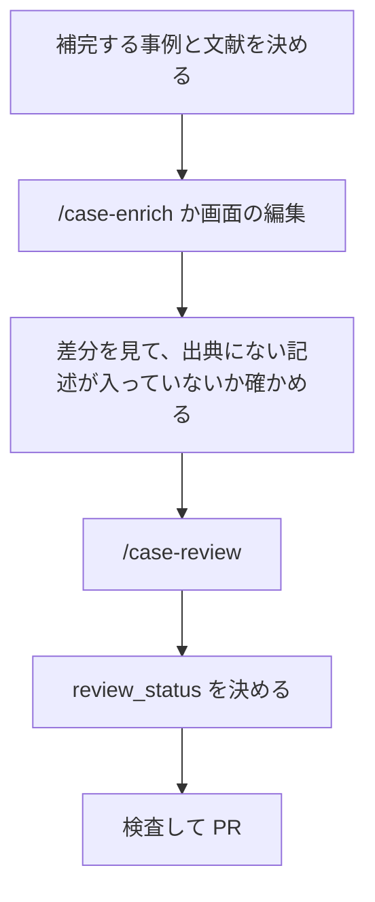

# 既存の事例を補完する

すでにある事例に、追加の文献で情報を足す手順です。「調査中」の項目を埋めるときや、出典を足すときに使います。

- **実例**：PR #231（NTTデータの事例に Hugging Face のブログと arXiv の出典、正確な数値を追加）、PR #233（既収録4件に OECD の出典を追記）

## 手順

1. 補完する事例 ID と、追加の文献を決める
2. 次のどちらかで補完する
   - Claude Code：`/case-enrich <事例ID> <文献のURL>`
   - 画面：事例の詳細 →「編集」→「AI で入力を補助する」。現在の case.json が入ったプロンプトが作られるので、文献と一緒に AI に渡し、出力を「AIの出力をインポート」に貼る
3. 差分（`git diff`）を見て、新しい文献に書かれていないことが足されていないか確かめる
4. `sources` に追加の文献を足し、`note` に何を参照したかを書く
5. `/case-review <事例ID>` を実行する
6. `review_status` を決める（下の表）
7. `updated_at` を今の日時にする
8. `npx tsx scripts/validate-cases.ts` を通して、`develop` 向けに PR を出す

## review_status をどうするか

| 変えた内容 | review_status |
|---|---|
| 出典やタグを足しただけで、記述は変えていない | そのまま |
| 記述を変えた（元が `human_reviewed`） | `ai_generated` に戻すか、人が新しい出典と照合してから `human_reviewed` のまま |
| 記述を変えた（元が `ai_generated`） | `ai_generated` のまま |

## 困ったとき

| 症状 | よくある原因 | 対処 |
|---|---|---|
| 補完で数値が変わった | 古い出典と新しい出典で値が違う | 両方の出典を `sources` に残し、どちらの値かを本文で書き分ける |
| 新しい文献が別の事例のことだった | 組織が同じで取り組みが違う | 補完をやめ、[事例を1件追加する](add-case.md)で別事例にする |
