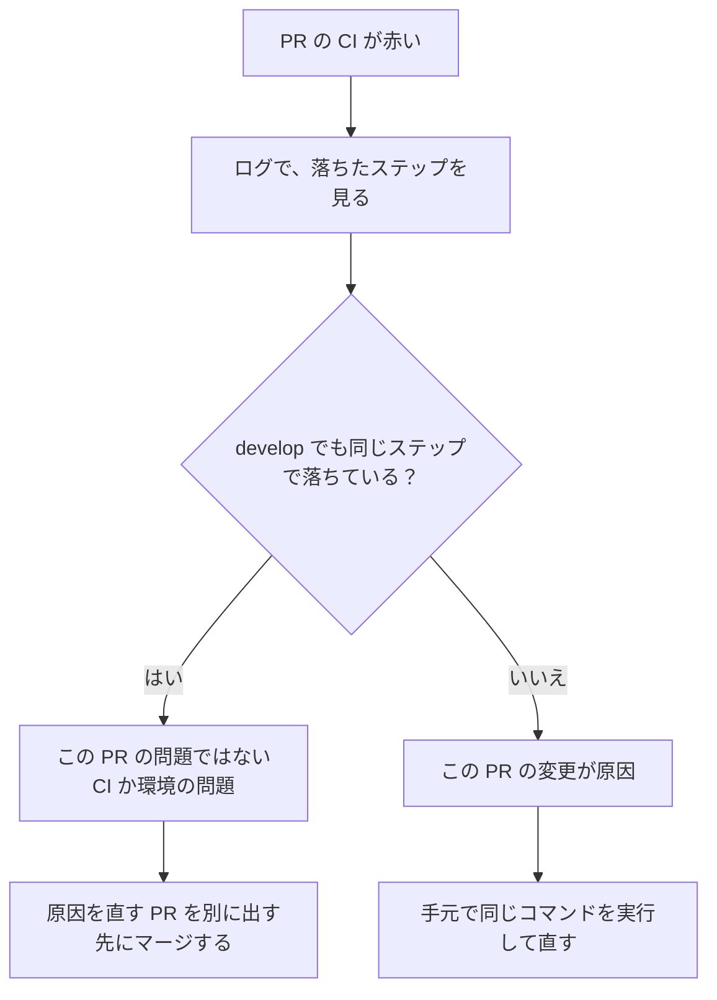

# CI が落ちたとき

PR の `validate-and-test` が赤くなったときに、原因を切り分けて直す手順です。

- **実例**：PR #242（GitHub のランナーが Ubuntu 26.04 に上がり、Playwright がブラウザを入れられなくなった）
- CI の中身は[環境と自動処理](../reference/environments.md)

## 切り分け

1. PR の「Checks」から `validate-and-test` を開き、赤いステップを見る
2. `develop` の最新の CI（GitHub の「Actions」→「CI」→ ブランチ `develop`）でも同じステップが落ちているかを見る
3. `develop` でも落ちていれば、この PR の問題ではありません。原因を直す PR を別に出し、先にマージします。この PR には、`develop` を取り込んで（`git merge origin/develop`）push し直します
4. この PR だけで落ちていれば、手元で同じコマンドを実行して直します

## ステップごとの手元での確かめ方

| CI のステップ | 手元で実行するコマンド |
|---|---|
| Validate case.json files | `npx tsx scripts/validate-cases.ts` |
| Type check | `npx tsc -b --noEmit` |
| Run tests | `npx vitest run` |
| Install Playwright browsers | `npx playwright install --with-deps chromium` |
| Run E2E tests | `npx playwright test` |

## やってはいけないこと

- テストを消す・飛ばす・無効にして緑にする
- 空のコミットを push する、PR を閉じて開き直すなどで、CI を動かし直そうとする
- 「たまたま落ちた」で済ませる（原因を見つける。動かし直すのは1回まで）

## 困ったとき

| 症状 | よくある原因 | 対処 |
|---|---|---|
| `Playwright does not support chromium on ubuntu26.04-x64` | ランナーの OS が新しくなった | `ci.yml` の `runs-on` を対応している版に固定する（PR #242）。Playwright が対応したら上げて戻す |
| Validate で `Missing required field` | case.json に `id`・`title`・`summary`・`sources` のどれかが無い | 足す（[case.json の形式](../reference/case-json.md)） |
| 手元の検査で `Directories not listed in index.json` | 手元の `index.json` が古い（CI では `index.json` が無いので出ない） | `npm run dev` か `npm run build` で作り直す（`index.json` はコミットしない） |
| Type check だけ落ちる | 型の定義とコードがずれた | 手元で `npx tsc -b --noEmit` を実行して直す |
| E2E だけ落ちる | 画面の文言や構造を変えた | `tests/e2e/cases.spec.ts` の期待値を、変えた仕様に合わせて直す |
