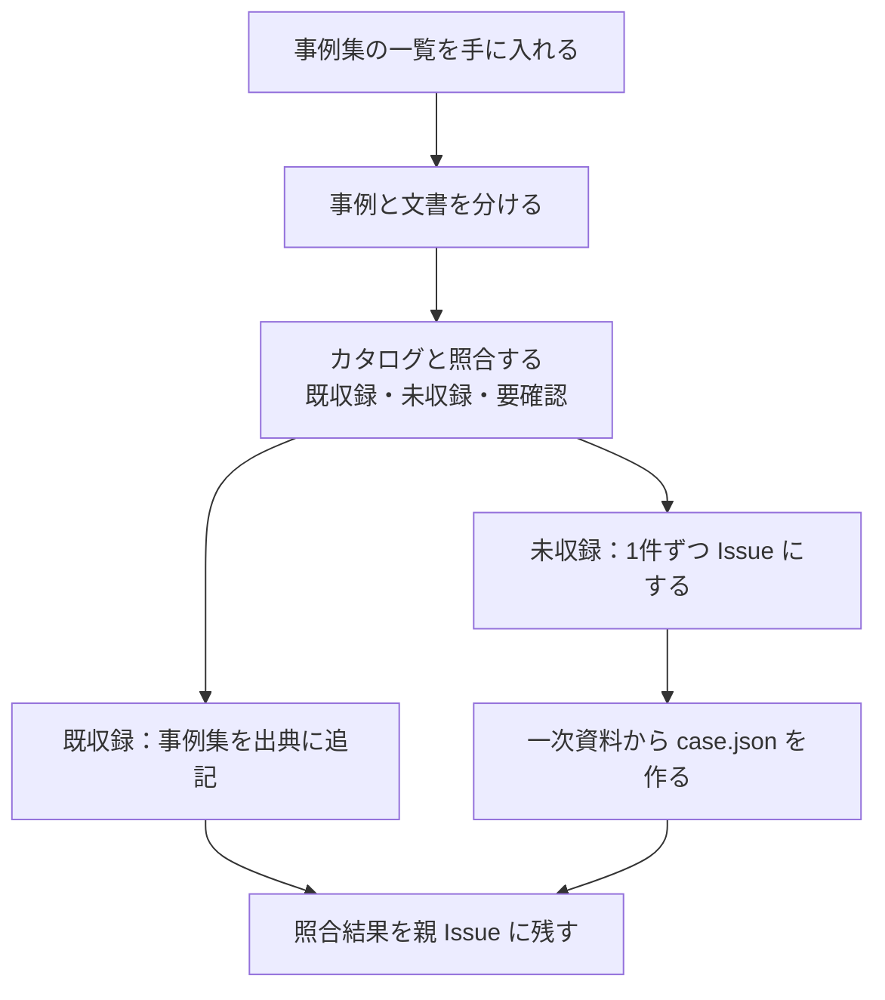

# 事例集からまとめて取り込む

OECD の PETs リポジトリ、UN の PETs ガイド、英国 CDEI のガイドのように、多くの事例をまとめて紹介している[事例集](../glossary.md#repository)から、カタログにない事例を取り込む手順です。

- **実例**：Issue #232（OECD PETs リポジトリ）→ PR #233、サブ Issue #234〜#241（UN ガイド）
- 1件ずつの作り方は[事例を1件追加する](add-case.md)

## 全体の流れ



## 1. 事例集の一覧を手に入れる

まずは普通にページを開きます。自動で取れないとき（ボット対策など）は、次の順に探します。

| 探すもの | 実例 |
|---|---|
| 公式の RSS や API | OECD：`https://api.oecd.org/webcms/search/rss?...&pageSize=100`（全件を返す） |
| PDF 版や Wiki 版 | UN：ガイドの PDF と事例 Wiki（`unstats.un.org/wiki/...`） |
| 人にコピーしてもらう | ページを全選択してコピー、貼り付けてもらう |

> ボット対策を回避する操作（ブラウザを装う、判定をすり抜ける）はしません。相手が機械向けに出している入口を探します。

## 2. 事例と文書を分ける

事例集には、事例のほかにガイドや報告書が混ざっています。OECD では 23件のうち 11件が事例、12件が文書でした。文書の中に事例がまとまっていることもあります（UN ガイドには 18事例）。

## 3. カタログと照合する

組織名と、日本語・英語のキーワードで検索し、1件ずつ次のどれかに分けます。

| 分類 | 判断 | 次にすること |
|---|---|---|
| 既収録 | 同じ組織・同じ取り組み | 手順4 |
| 未収録 | 見つからない | 手順5 |
| 要確認 | 組織や目的が一部だけ重なる | Issue に「重複確認」のチェック項目を入れる |

```bash
grep -l -i "<組織名やキーワード>" public/cases/*/case.json
```

## 4. 既収録の事例に、事例集を出典として追記する

記述は変えず、次の3つだけを足します（実例：PR #233 の既収録4件）。

1. `sources` に事例集のページを1件。読めなかったら `note` に「本文未確認、概要のみ確認」と書く
2. `tags` に事例集のタグ（例：`OECD PETs Repository`）
3. `updated_at` を今の日時に

記述を変えていないので、`review_status` はそのままにします。

## 5. 未収録の事例を1件ずつ Issue にする

親 Issue のサブ Issue として、[事例を1件追加する](add-case.md)の形式で作ります。

- 事例集の要約表から「事例の要点」を書く
- 事例集に載っている外部資料のリンクを「情報源候補」に並べる
- 実データでの活用でないもの（ランダムなデータや公開データでの技術実証）は「掲載方針（要判断）」にする

## 6. 照合結果を親 Issue に残す

親 Issue に、事例集の全件と、それぞれの扱い（既収録の ID・作った Issue 番号・未作成の理由）を表にしてコメントします。あとから「どれを確認したか」を追えるようにするためです。

## 困ったとき

| 症状 | よくある原因 | 対処 |
|---|---|---|
| ページが 403 や「Just a moment...」になる | ボット対策 | 手順1の表の順に、RSS・API・PDF を探す |
| 一覧の件数が公表数より少ない | ページ送りで一部しか返っていない | `pageSize` などのパラメータを試す。OECD の RSS は既定で15件 |
| 一次資料が見つからない | 事例集にしか載っていない | 事例集だけを出典にせず、未作成として親 Issue に理由を書く |
| 既存の事例が二重に登録されている | 過去に別の事例集から取り込んだ | 別の Issue にして整理する（取り込みとは混ぜない） |
