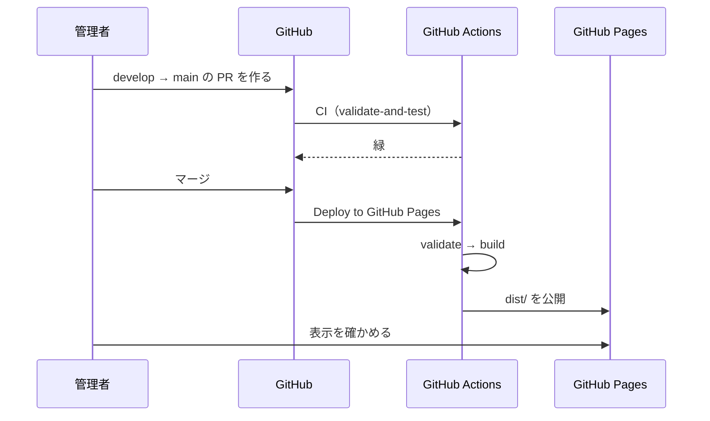

# 本番に出す

`develop` に溜まった変更を `main` にマージし、GitHub Pages に公開する手順です。管理者が行います。

- **実例**：PR #95・#89・#82（`develop` → `main` のマージ PR）
- 公開の仕組みは[環境と自動処理](../reference/environments.md)

## 流れ

## 手順

1. `develop` の CI が緑であることを確かめる
2. `develop` → `main` の PR を作る。タイトルは「develop を main にマージ」など。本文に、含まれる PR の一覧を書く
3. CI（`validate-and-test`）が緑になるのを待つ
4. マージする（マージコミットで）
5. GitHub の「Actions」で「Deploy to GitHub Pages」が成功したことを確かめる
6. 公開されたカタログを開き、次を見る
   - 一覧が表示され、件数が増えている（追加した事例がある場合）
   - 追加・変更した事例の詳細が開ける
   - 統計ページが表示される

## チェックリスト

- [ ] `develop` の CI が緑
- [ ] PR 本文に含まれる変更を書いた
- [ ] デプロイが成功した
- [ ] 公開後の画面を確かめた

## 困ったとき

| 症状 | よくある原因 | 対処 |
|---|---|---|
| デプロイが「Validate case.json files」で落ちる | 不正な case.json が混ざった | `npx tsx scripts/validate-cases.ts` で該当事例を見つけ、`develop` で直してから出し直す |
| 公開されたのに古い表示のまま | ブラウザのキャッシュ | 強制再読み込み（Ctrl+Shift+R） |
| `main` と `develop` がずれた | `main` に直接変更が入った | `main` を `develop` にマージしてそろえる（過去の実例：2026-03-25 のマージ） |
