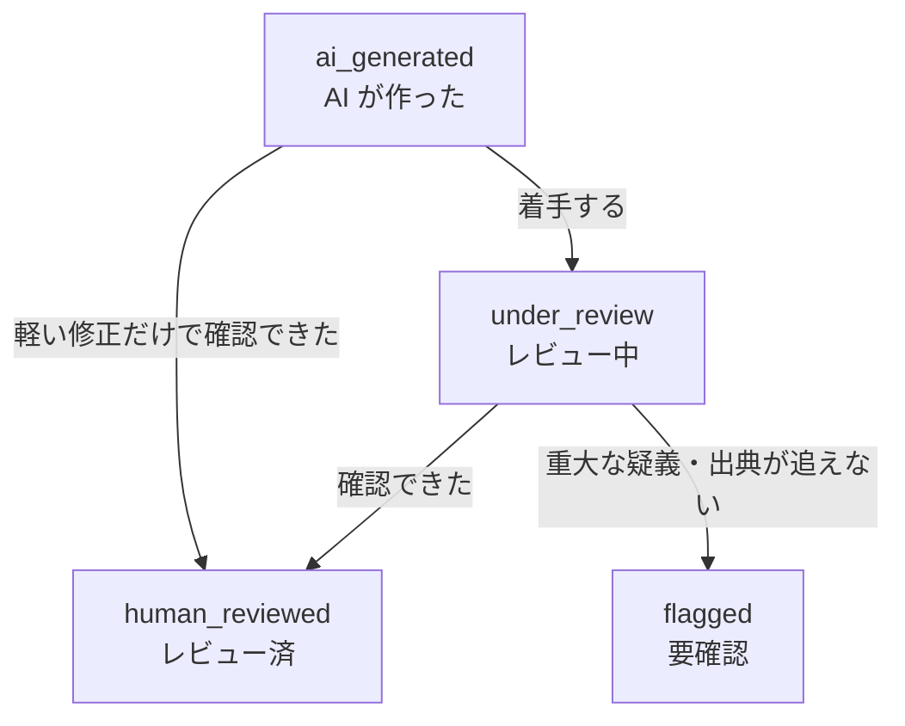

# 事例をレビューする

AI が作った事例（`review_status: "ai_generated"`）を、人が出典と照合して `human_reviewed` に上げる手順です。

- **実例**：PR #221（複数事例をまとめてレビュー済みに）、Issue #183〜#214（レビューの確認点を1件ずつ Issue にしたもの。ラベル `review-triage`）
- 状態の意味と、なぜこの仕組みなのかは[事例の作り方とレビューの仕組み](../explanation/review-lifecycle.md)

## review_status の遷移



| 値 | 画面の表示 | 意味 |
|---|---|---|
| `ai_generated` | 黄色「未レビュー」＋注意書き | AI が文献から作り、人の目がまだ入っていない |
| `under_review` | 青「レビュー中」 | 誰かがレビュー中（着手の宣言） |
| `human_reviewed` | 緑「レビュー済」 | 人が出典と照合し、妥当と判断した |
| `flagged` | 赤「要確認」＋注意書き | 重大な疑義がある、または出典が追えない |

## やり方 A：画面から（GitHub アカウントだけでできる）

1. カタログで黄色の「未レビュー」バッジの事例を開く（一覧のフィルタ「レビュー状態」で絞り込める）
2. 詳細ページ下部の「編集」を押す
3. 「レビュー状況」で「レビュー済」を選ぶと、チェックリストが出る。すべて確かめる
   - 出典 URL（sources）の実物を開いて本文を確認した
   - summary と value_proposition の記述は出典で裏付けられている
   - 数値・固有名詞・組織名は出典と一致している
   - 断定表現（「〜に価値がある」「〜を実現した」など）を避け、出典の引用と解釈が区別できる
   - title が `{組織名}：{事例内容}` の形になっている
4. 問題があれば同じフォームで直す
5. 「プレビュー」を押すと、推奨のコミットメッセージが出る（例：`review: {title} を 未レビュー → レビュー済 に更新`）
6. 「GitHubで提出」を押す。JSON がクリップボードに入り、GitHub の編集画面が開く
7. 中身を貼り替えてコミットし、PR を作る。**PR の base を `develop` に変える**

> 「GitHubで提出」は `main` ブランチの編集画面を開きます。そのまま PR を作ると `main` 向けになるので、base を `develop` に変えてください。

## やり方 B：手元で（開発者向け）

1. `develop` から作業ブランチを切る

   ```bash
   git switch develop && git pull
   git switch -c feature-review-<事例IDの先頭>
   ```

2. Claude Code で `/case-review <事例ID>` を実行する（5つの観点で出典と照合する）
3. 指摘を反映し、結果に応じて `review_status` を決める（下の表）
4. `updated_at` を今の日時（ISO 8601、UTC）にする
5. 検査してコミットし、PR を出す

   ```bash
   npx tsx scripts/validate-cases.ts
   git add public/cases/<事例ID>/case.json
   git commit -m "review: <title の要約> を 未レビュー → レビュー済 に更新"
   git push -u origin HEAD
   ```

PR 本文には、参照した出典 URL、直した内容、気づいた点を書きます。

## レビュー結果と review_status

| 総合判定 | すること | review_status |
|---|---|---|
| 正確 | そのまま | `human_reviewed` |
| 概ね正確 | 指摘を直す | `human_reviewed` |
| 要修正（軽微） | 直す | `human_reviewed` |
| 要修正（重大）／根拠不足が多い | 直せない・追加調査が要る | `flagged` |
| 事例として不適切 | 削除を検討（別 PR で議論） | そのまま、または `flagged` |

## 困ったとき

| 症状 | よくある原因 | 対処 |
|---|---|---|
| 出典 URL が開けない | リンク切れ・ボット対策 | Wayback Machine を試す。代わりの出典もなければ `flagged` にして Issue を立てる |
| 出典と記述が食い違う | AI が推測で書いた | 出典で確かめられる範囲に書き直す。断定は「〜とされている」に弱める。直しきれなければ `flagged` |
| 1つの事例に複数の取り組みが混ざっている | 文献に複数の事例があった | 別の case.json に分ける（別 PR）。元の事例は代表の1件に絞る |
| PR が `main` 向けになった | 「GitHubで提出」は `main` を開く | PR の base を `develop` に変える |
