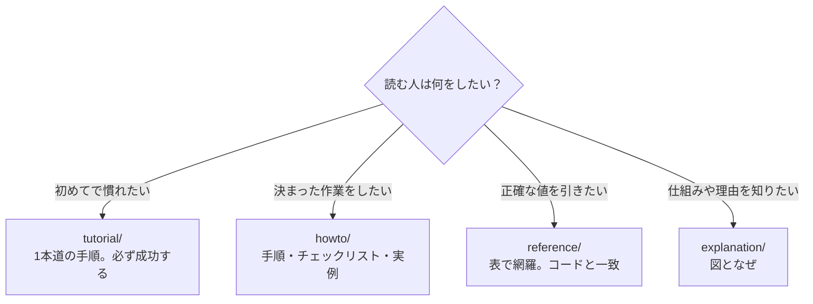

# ドキュメントを書く

`docs/` にドキュメントを足す・直すときの手順と決まりです。

- **実例**：このドキュメント一式を作った PR（ドキュメント再編）

## 決まり

1. **原本は Markdown だけ**。本文は `docs/*.md` に書く。`docs/index.html` と `docs/slides.html` は表示するだけで、本文を持たない
2. **人と AI が同じものを読む**。AI 向けの別資料は作らない。`CLAUDE.md` は短くし、`docs/` を指す
3. **1つのファイルに種類を混ぜない**。チュートリアル・ハウツー・リファレンス・解説のどれかにする
4. **初めての人を基準に書く**。専門用語は[用語集](../glossary.md)に入れ、初出でリンクする
5. **「なぜ」を残す**。判断と失敗は[これまでの判断と失敗](../explanation/history.md)の先頭に足す
6. **コードと食い違わせない**。仕様を変えたら同じ PR で直す。食い違ったらコードが正

## どこに置くか



| 種類 | 書くこと | 書かないこと |
|---|---|---|
| チュートリアル | 1本道の手順。所要時間とゴールを先に | 選択肢や例外 |
| ハウツー | 手順・確認表・チェックリスト・実例（PR 番号など） | 仕組みの長い説明（解説へリンク） |
| リファレンス | 表で網羅。コードと一致させる | 手順や理由 |
| 解説 | 図と「なぜ」 | 手順 |

## 書き方

- 短い段落、表、箇条書きで、拾い読みできるようにする
- 流れは Mermaid の `flowchart TD`（縦向き）、やりとりは `sequenceDiagram`。横長の図は避ける
- パスはリポジトリからの相対で書く（例：`scripts/validate-cases.ts`）
- ハウツーには実例（PR 番号・Issue 番号）を添える
- 「困ったとき」の表（症状 → よくある原因 → 対処）を置く

### Mermaid の注意

- 改行は `<br>`
- `(` `)` `[` `]` を含む文字は `"..."` で囲む
- `<` `>` は `&lt;` `&gt;` と書く

### 判断と失敗の記録

`docs/explanation/history.md` の先頭に、次の形で足します。

```markdown
## YYYY-MM 見出し（何が起きた／何を決めた）

- **起きたこと／決めたこと**：
- **なぜ**：
- **どうした**：
- **今の決まり**：（関係するハウツーやリファレンスへのリンク）
```

同じ種類の問題が繰り返したら、1つの項目にまとめて表にし、共通の原因と今の決まりを書きます。

## ドキュメントを足すときにそろえる3か所

1. 該当フォルダに `.md` を置く
2. `docs/README.md` の「全ドキュメント」の表に1行足す
3. `docs/index.html` の `DOCS` 配列に1行足す

   ```js
   { path: 'howto/new-task.md', title: '新しい作業', group: 'ハウツー' },
   ```

   `group` は `案内`・`チュートリアル`・`ハウツー`・`リファレンス`・`解説` のどれか

スライドと食い違ったら、同じ PR で `docs/slides.md` も直します。スライドは `---` だけの行で区切り、1枚に見出し1つと、箇条書きか表を1つにします。

## 表示を確かめる

リポジトリの直下で、簡単な Web サーバーを立てます。

```bash
python3 -m http.server 8000
```

- 閲覧ページ：`http://localhost:8000/docs/index.html`（例：`#howto/add-case` でそのドキュメントが開く）
- スライド：`http://localhost:8000/docs/slides.html`（← → キーかクリックで進む。`#5` で5枚目）

PC とスマホ（ブラウザの開発者ツールで幅を狭める）、ライトとダークの両方で見ます。

> ファイルを直接開く（`file://`）と、ブラウザの制限で Markdown を読み込めません。必ずサーバー経由で開きます。

## 公開先

ドキュメントは本番（GitHub Pages）には出しません。本番のビルド（`dist/`）には `index.html`（アプリ）と `public/` だけが入り、`docs/` と `CLAUDE.md` は入りません。

閲覧ページとスライドは、[raw.githack.com](https://raw.githack.com/) を通して GitHub 上のファイルをそのまま表示して読みます。設定やデプロイは要りません（リポジトリが公開であることが前提）。

| 見たいもの | URL |
|---|---|
| `develop` の閲覧ページ | https://raw.githack.com/pwscup/pets-usecase-catalog/develop/docs/index.html |
| `develop` のスライド | https://raw.githack.com/pwscup/pets-usecase-catalog/develop/docs/slides.html |
| 作業ブランチの閲覧ページ | `https://raw.githack.com/pwscup/pets-usecase-catalog/<ブランチ名>/docs/index.html` |

- push してから反映されるまで、数分かかることがあります
- 外部の無料サービスなので、止まっているときは手元のサーバーか GitHub のファイル表示で読みます

## PR のチェックリスト（ドキュメントに関わる変更）

- [ ] 仕様の変更に合わせて `docs/` を直した
- [ ] 新しいドキュメントを `README.md` の表と `index.html` の `DOCS` に足した
- [ ] 新しい用語を用語集に足した
- [ ] 判断や失敗を `history.md` に記録した
- [ ] HTML に本文を書いていない

## 困ったとき

| 症状 | よくある原因 | 対処 |
|---|---|---|
| 閲覧ページが「読み込めませんでした」になる | `file://` で開いた、パスが違う | サーバー経由で開く。`DOCS` の `path` を確かめる |
| raw.githack.com で古い内容が出る | 反映待ち・キャッシュ | 数分待って再読み込みする。急ぐときは手元のサーバーで見る |
| 図が出ずにコードのまま表示される | Mermaid の文法の誤り、または CDN に届かない | 括弧を `"..."` で囲む。CDN に届かないときは原文がそのまま出る作り |
| 目次に出ない | `DOCS` に足していない | `docs/index.html` の `DOCS` に1行足す |
| リンクを押すと GitHub が開く | `docs/` の外のファイルへのリンク | そういう作り。`docs/` 内の `.md` だけが閲覧ページ内で開く |
