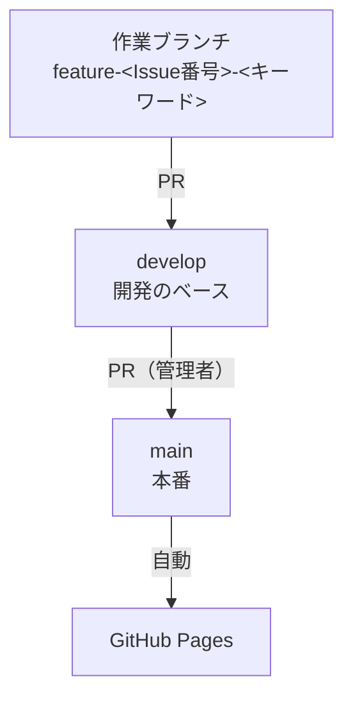

# 環境と自動処理

## 環境

| 環境 | どこ | 何が出るか | いつ更新されるか |
|---|---|---|---|
| 手元（開発） | `npm run dev` → `http://localhost:5173` | 作業中のアプリ | ファイルを保存するたび |
| 手元（本番と同じ形） | `npm run build && npm run preview` → `http://localhost:4173` | `dist/` | 実行したとき |
| 本番 | GitHub Pages（リポジトリの Settings → Pages に URL） | `dist/`（アプリと `public/cases/`） | `main` に push されたとき |
| ドキュメント | https://raw.githack.com/pwscup/pets-usecase-catalog/develop/docs/index.html（raw.githack.com 経由） | `develop` の `docs/` | `develop` に push されてから数分後 |
| ドキュメント（手元） | `python3 -m http.server 8000` → `http://localhost:8000/docs/index.html` | 作業中の `docs/` | 実行したとき |

- 開発用の確認環境は、ドキュメントの閲覧（raw.githack.com）だけです。`develop` のアプリの画面を確認する環境や、PR ごとのプレビューはありません
- 本番に出るのは `dist/` だけです。`docs/` と `CLAUDE.md` は本番に出ません

## ブランチ

| ブランチ | 役割 | 直接コミット |
|---|---|---|
| `main` | 本番。push で公開される | しない |
| `develop` | 開発のベース。PR はここ向け | しない |
| `feature-<Issue番号>-<キーワード>` | 作業用。`develop` から切る | する |

## 自動処理（GitHub Actions）

| ワークフロー | いつ動くか | すること |
|---|---|---|
| CI（`.github/workflows/ci.yml`） | `main`・`develop` 向けの PR、`main`・`develop` への push | case.json の検査 → 参考資料の検査 → 型チェック → 単体テスト → Playwright のブラウザを入れる → E2E テスト |
| Deploy to GitHub Pages（`.github/workflows/deploy.yml`） | `main` への push、手動実行 | case.json の検査 → 参考資料の検査 → `npm run build` → `dist/` を GitHub Pages に公開 |

- CI のランナーは `ubuntu-24.04` に固定しています（Ubuntu 26.04 では Playwright 1.58 がブラウザを入れられないため。PR #242）
- 定期実行（決まった時刻に動く処理）はありません

## 権限

| すること | 必要な権限 |
|---|---|
| Issue を立てる | GitHub アカウント |
| PR を出す（画面の「GitHubで提出」を含む） | GitHub アカウント（書き込み権限がなければフォークから） |
| PR を `develop` にマージする | リポジトリの書き込み権限 |
| `develop` を `main` にマージする（本番に出す） | 管理者 |

## 困ったとき

| 症状 | よくある原因 | 対処 |
|---|---|---|
| 追加した事例が一覧に出ない | `index.json` が古い、`case.json` のパスが違う、`title` か `id` が無い | `npm run dev` を起動し直す。パスが `public/cases/<id>/case.json` か確かめる。ブラウザのコンソールに `Skipping invalid case` が出ていないか見る |
| `develop` にマージしたのに本番に出ない | 本番は `main` から出る | [本番に出す](../howto/release.md) |
| デプロイが失敗した | case.json の検査で落ちた | Actions のログで該当事例を見つけ、`develop` で直してから出し直す |
| 手元では動くのに CI だけ落ちる | ランナーの OS・ブラウザの違い | [CI が落ちたとき](../howto/fix-ci.md) |
| `npm run validate` が `tsx: not found` | `tsx` が依存に入っていない | `npx tsx scripts/validate-cases.ts` を使う |
