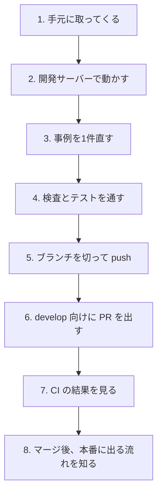
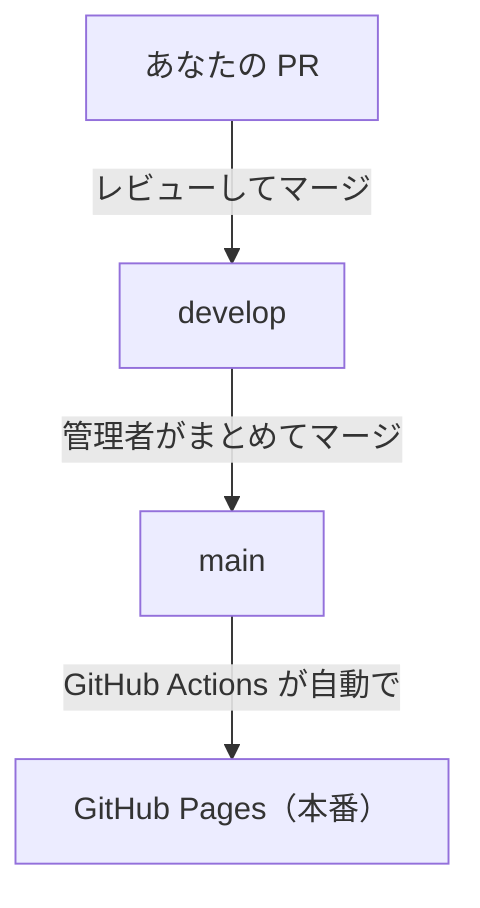

# はじめての貢献

手元でカタログを動かし、事例を1件だけ小さく直して、PR を出すところまでを一通り体験します。

- **所要時間**：40分ほど
- **ゴール**：自分の PR が `develop` 向けに出ていて、CI が緑になっている
- **前提**：GitHub アカウントがあり、このリポジトリに push できる。Git と Node.js 20 以上が入っている



## 1. 手元に取ってくる

```bash
git clone https://github.com/pwscup/pets-usecase-catalog.git
cd pets-usecase-catalog
git switch develop
npm ci
```

`npm ci` は `package-lock.json` のとおりに部品を入れるコマンドです。

## 2. 開発サーバーで動かす

```bash
npm run dev
```

ブラウザで `http://localhost:5173` を開くと、事例の一覧が出ます。カードを1つ開いて、詳細画面も見ておきます。

> サーバーの起動時に `public/cases/index.json` が自動で作られます（[index.json](../glossary.md#index-json)）。手で作る必要はありません。

## 3. 事例を1件直す

ここでは「検索用のタグを1つ足す」という小さな変更をします。

1. 一覧で気になる事例を開き、URL の `#/cases/` の後ろにある事例 ID を控える
2. `public/cases/<事例ID>/case.json` をエディタで開く
3. `tags` の配列に、検索に役立つ言葉を1つ足す。たとえば `"tags": ["Pilot", "TEE"]` を `"tags": ["Pilot", "TEE", "観光統計"]` にする
4. `updated_at` を今の日時（例：`2026-11-22T00:00:00.000Z`）にする
5. ブラウザを再読み込みし、一覧の検索ボックスに足したタグを入れて、その事例が出ることを確かめる

> 足すタグは、出典に書かれている内容に沿ったものにします（[設計の原則](../explanation/principles.md)）。

## 4. 検査とテストを通す

開発サーバーを `Ctrl+C` で止めてから、次の3つを順に実行します。

```bash
npx tsx scripts/validate-cases.ts
```

```bash
npm run test
```

```bash
npm run build
```

3つとも最後にエラーが出なければ成功です。`validate` は最後に `All cases are valid.` と出ます。

本番と同じ形でも見ておきます。

```bash
npm run preview
```

表示された URL（`http://localhost:4173` など）を開き、手順3で直した事例を確かめます。

## 5. ブランチを切って push

```bash
git switch -c feature-<Issue番号>-<短い説明>
git add public/cases/<事例ID>/case.json
git commit -m "feat: <事例の組織名>の事例に検索タグを追加"
git push -u origin HEAD
```

ブランチ名は `feature-<Issue番号>-<キーワード>` が決まりです。Issue がなければ `feature-<キーワード>` で構いません。

## 6. develop 向けに PR を出す

push すると、GitHub の画面に「Compare & pull request」が出ます。

1. **base を `develop` にする**（`main` ではない）
2. タイトルにコミットと同じ内容を書く
3. 本文に、何を直したかと、確かめた手順（手順4の3つ）を書く
4. まだ練習なら「Create draft pull request」を選ぶ

## 7. CI の結果を見る

PR の下のほうに `validate-and-test` が出ます。2〜3分で緑のチェックになれば成功です。

赤い ✕ になったら、[CI が落ちたとき](../howto/fix-ci.md)を見ます。

> 練習の変更で、取り込む必要がないものなら、PR を閉じてブランチを消して構いません。

## 8. マージ後、本番に出る流れを知る

PR が `develop` にマージされても、まだ公開はされません。管理者が `develop` を `main` にマージすると、GitHub Pages に自動で公開されます（[本番に出す](../howto/release.md)）。



## 次に読むもの

- 新しい事例を作る：[事例を1件追加する](../howto/add-case.md)
- 仕組みを知る：[全体の構成](../explanation/architecture.md)
